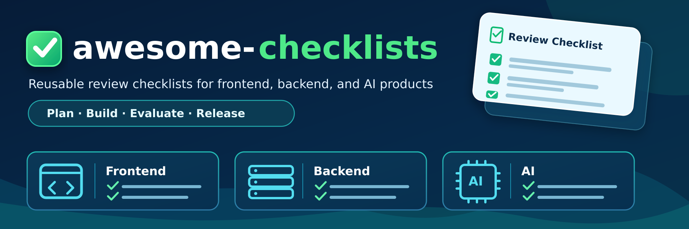

# Awesome Checklists [](https://awesome.re)



**Build with intention. Review with evidence. Launch with fewer blind spots.**

> A curated, evidence-oriented checklist library for production Generative AI, LLMOps, autonomous agents, and the supporting software needed to ship them safely.

**91 scoped checklists · 4,215 unique checks · 4 complementary review scopes**

Great products are rarely derailed by one spectacular mistake. More often, the problems are questions nobody asked, assumptions nobody tested, and responsibilities nobody owned.

**Awesome Checklists** helps teams ask those questions *before* they become expensive surprises. Use it to turn vague readiness discussions into structured, evidence-based reviews—without reinventing a process for every project.

**Short curated Awesome index:** [AWESOME.md](AWESOME.md) is the linted, phase-oriented selection; this README documents the full source library and agent skill.

## Contents

- [Prompt & Context Engineering](#prompt-context-engineering)
- [RAG & Data Pipelines](#rag-data-pipelines)
- [Agent Safety & Runtime Guardrails](#agent-safety-runtime-guardrails)
- [Evaluation & Observability](#evaluation-observability)
- [Production Readiness](#production-readiness)
- [Explore the full checklist library](#explore-the-checklists)
- [How to use these checklists](#how-to-use-these-checklists)

## Production GenAI lifecycle

These phase-oriented [drop-in PR/issue templates](checklists/README.md) complement, rather than replace, the existing 91 numbered source checklists. Each item links to its canonical stable ID and explains the failure mode it helps detect. `[PR Template]`, `[Security Audit]`, `[Eval Benchmark]`, and `[Runtime Guardrail]` are editorial navigation tags, not certifications or claims that a check was run.

### Prompt & Context Engineering

`[PR Template]` [Prompt and context checklist](checklists/prompt-context.md) — verify trust boundaries, strict output schemas, context-token budgets, truncation and injection resistance before a prompt or tool schema change. Source: [Prompt engineering and versioning](lists/AI/09_Prompt_Engineering_and_Versioning.md).

### RAG & Data Pipelines

`[Eval Benchmark]` [RAG and data checklist](checklists/rag-data.md) — prevent broken document chunking, incompatible embeddings, partial index swaps, unmeasured retrieval loss and stale/deleted vector data. Sources: [RAG and knowledge bases](lists/AI/10_RAG_and_Knowledge_Bases.md) and [AI evaluation](lists/AI/15_AI_Evaluation_and_Regression.md).

### Agent Safety & Runtime Guardrails

`[Runtime Guardrail]` [Agent safety checklist](checklists/agent-safety.md) — validate tool registry membership, operation-level permissions, prompt-injection defenses, handoff traces and partial-stream action boundaries. Sources: [Tool orchestration](lists/AI/11_AI_Agents_and_Tool_Orchestration.md), [red-teaming](lists/AI/16_AI_Red_Teaming_and_Guardrails.md) and [streaming inference](lists/AI/12_AI_Inference_and_Serving.md).

### Evaluation & Observability

`[Eval Benchmark]` [Evaluation and observability checklist](checklists/evaluation-observability.md) — catch regressions by keeping golden cases, schema and tool assertions, retrieval quality, user-visible latency and usage costs separate. Sources: [Evaluation and regression](lists/AI/15_AI_Evaluation_and_Regression.md) and [AI monitoring and drift](lists/AI/18_AI_Monitoring_and_Drift.md).

### Production Readiness

`[Security Audit]` [Production readiness checklist](checklists/production-readiness.md) — verify cold-start behavior, secrets scanning, quotas, dependency/container patching and rate-limit recovery before promoting a release. Sources: [Backend operations](lists/backend/30_DevOps_and_CI_CD.md), [performance](lists/backend/27_Performance_and_Scalability.md) and [inference serving](lists/AI/12_AI_Inference_and_Serving.md).

### Pro-GenAI implementation companions

Use these projects as examples of **where to apply** the checklists, not proof that a dependency is safe or that an audit passed.

| Ecosystem project | Checklist connection and specific reason |
| --- | --- |
| [Agent-RT](https://github.com/Pro-GenAI/Agent-RT) | `[Runtime Guardrail]` Test the agent runtime's tool permissions, checkpoints, streaming and observability boundaries before production use. |
| [Agent-Action-Guard](https://github.com/Pro-GenAI/Agent-Action-Guard) | `[Security Audit]` Evaluate real-time tool/action classification alongside server-side authorization; classifiers do not replace permissions. |
| [Safe-LLM](https://github.com/Pro-GenAI/Safe-LLM) | `[Eval Benchmark]` Recheck held-out harmful-action and legitimate tool-call outcomes for the specific deployment, not just a project benchmark. |
| [Large-Supervisor-Models](https://github.com/Pro-GenAI/Large-Supervisor-Models) | `[Runtime Guardrail]` Test interruption timing, unsafe partial streams and false positives before using stream supervision. |
| [Agent-Swarm-Eval](https://github.com/Pro-GenAI/Agent-Swarm-Eval) | `[Eval Benchmark]` Use reproducible multi-agent task cases, observed tool side effects and regression thresholds when applicable. |
| [gen-ai-project-template](https://github.com/Pro-GenAI/gen-ai-project-template) | `[PR Template]` Review lazy initialization, Milvus/RAG setup, deployment configuration and secret handling before inheriting starter defaults. |

## Start with 25–50 checks

**Do not attempt all 4,215 checks.** Start with the [Core 50 curated starter](lists/references/core-50.md) or the [25-check starter for each relevant scope](lists/references/minimum-viable-by-scope.md). You can also [generate a focused, UNKNOWN-first project review](lists/references/scoped-review-generator.md) rather than copying the entire source library.

Only the **Core 50 priority tiers** are individually curated; all other tiers are **provisional, text-derived suggestions**. The generator does **not use provisional P0/P1/P2 labels for selection ranking**. Determine project-specific severity from real threats, obligations, evidence and qualified human review. No independent field validation or external reviewer sign-off is claimed.

**Pinned-source default:** The installable skill uses the immutable checklist commit identified in [its bundled source-release metadata](skills/awesome-checklists/references/source-release.json), not moving `main`. The install command below fetches the *skill package* from the repository at installation time; for a fully frozen installation, check out a specific commit before installing the local skill. Always record both the checklist-source SHA and the reviewed project's revision. The latest documentation on `main` may include changes not yet included in a pinned release.
## Agent skill for Codex and Claude Code

**Use these checklists directly in your coding agent.** The [`awesome-checklists` agent skill](skills/awesome-checklists/SKILL.md) teaches Codex, Claude Code, and other Agent Skills-compatible tools to choose relevant reviews, retrieve revision-pinned checklist criteria, inspect real project evidence, and report actionable findings with stable IDs.

From the project you want to review, install the skill using the [Skills CLI](https://github.com/vercel-labs/skills):

```bash
npx skills add https://github.com/Pro-GenAI/awesome-checklists --skill awesome-checklists -a codex -a claude-code
```

To install for just one agent, use `-a codex` or `-a claude-code`; add `-g` for a global installation. Discover the packaged skill without installing it with `npx skills add Pro-GenAI/awesome-checklists --list`. The CLI requires a supported Node.js release (currently Node.js 22.20+).

> **Public repository:** The skill can be installed and its checklists retrieved anonymously while GitHub's public access and rate limits permit. Authentication (`gh auth login`, `GH_TOKEN`, or `GITHUB_TOKEN`) is optional for readers and can help with API rate limits. SSH installation is also supported when you have configured SSH credentials.

After installation, ask an agent: **“Review this app's release readiness using awesome-checklists; cite actual checklist IDs and evidence for each finding.”** Other examples: “Audit our API security and database controls,” or “Assess this RAG/agent implementation for evaluation and guardrail gaps.”

**Reproducibility:** the checklist fetch helper reads its immutable default SHA from [source-release.json](skills/awesome-checklists/references/source-release.json), **not moving `main`**. Every review must record its checklist-source SHA and the reviewed project revision separately. The quick `npx skills add` command above is an unpinned convenience installation of the skill itself; do not mistake it for a frozen review source. For multi-file work, use `fetch-many` (maximum five files) or the public `--raw` mode if the API is rate-limited.

The skill includes a standard-library [checklist fetch helper](skills/awesome-checklists/scripts/checklists.py), a [domain selection guide](skills/awesome-checklists/references/domain-selection.md), and [offline unit tests](skills/awesome-checklists/tests/test_checklists.py). It **does not** copy or claim to certify all checks; it loads relevant upstream files when accessible.

## Why use this repository?

**What is new here—and what is not:** OWASP ASVS, NIST AI RMF, accessibility guidance and established release-readiness practices already cover many of these topics. The repository's contribution is a cross-scope synthesis with stable IDs, agent-assisted retrieval, bounded review generation and evidence-record conventions—not novel security standards or an independent certification. Its source files have not all received independent expert or field validation; low or high GitHub engagement is not a substitute for that evidence. See [authorship and validation limits](AUTHORSHIP.md).

- **Spot blind spots earlier.** Surface overlooked requirements, security risks, accessibility gaps, operational dependencies, and AI-specific failure modes.
- **Make reviews actionable.** Checks are written to prompt verification, not just agreement. Record evidence, ownership, exceptions, and follow-up work in your project's review records.
- **Create a shared language.** Stable checklist IDs make it easier to discuss findings across engineering, product, QA, security, and operations.
- **Start wherever you are.** Use relevant checks during discovery, implementation, release review, or post-launch changes—not only on launch day.
- **Adapt to your context.** Choose the scopes and checks that matter for your product, rather than treating every item as mandatory.

## Explore the checklists

All 91 numbered checklist files live in [`lists/`](lists/): shared checklists directly in `lists/`, and the other scopes in `lists/frontend/`, `lists/backend/`, and `lists/AI/`. The repository separates shared concerns from implementation-specific checks so that each review can focus on the right work. **AI-specific interface checks (including fine-tuning dashboards and agent interfaces) live under `lists/AI/` in their domain's `Frontend Checks` section**, rather than as separate AI-domain files under `lists/frontend/`. General frontend checks remain under `lists/frontend/`.

| Scope | Files | Checks | What it covers |
| --- | ---: | ---: | --- |
| **[Shared / cross-cutting](lists/)** | 14 | 701 | Planning, legal considerations, architecture, security, testing, reliability, operations, metrics, and launch decisions |
| **[Frontend](lists/frontend/)** | 20 | 684 | UI/UX, accessibility, browser/API integration, performance, SEO, operations, and release checks |
| **[Backend](lists/backend/)** | 35 | 1,118 | APIs, data management, services, infrastructure, security, operations, and applicable AI integrations |
| **[AI](lists/AI/)** | 22 | 1,712 | Model selection, training, RAG, agents, evaluation, guardrails, monitoring, and their AI-specific frontend integration checks |
| **Total** | **91** | **4,215** | |

*Counts reflect the repository's current inventory and may change as checklists evolve. Numbered filenames reflect the historical organization within each `lists/` folder; existing filename prefixes are frozen to preserve external links, and future gaps are allowed. Stable checklist IDs, not filename numbers, are the durable review references.*

**Reproduce the inventory from source.** At a checked-out revision, run:

```bash
python3 skills/awesome-checklists/scripts/validate_inventory.py
python3 skills/awesome-checklists/scripts/generate_inventory.py --check
python3 skills/awesome-checklists/scripts/generate_id_prefixes.py --check
```

The [machine-readable inventory](lists/references/inventory.json) records the 14/20/35/22 file counts and 701/684/1,118/1,712 formatted checks (4,215 total). The source validator counts actual numbered Markdown checklist entries, enforces uniqueness, and compares them against the tracked manifest. **These are mechanically verifiable counts, not 4,215 independently tested or semantically distinct assurances.** The stable ID prefix registry explains why `SEC-007` can belong to the backend file while `SEC-040` appears beside earlier shared security checks; renumbering to make one file sequential would break downstream review history. See [ID history and ownership](lists/references/id-history.md).

### Begin with a smaller, risk-tiered review

For a first pass, use the [Core 50 starter review](lists/references/core-50.md): **12 shared, 12 frontend, 12 backend and 14 AI checks**, all drawn from existing stable IDs. Choose **only applicable** scopes and add checks for your system's architecture, threat model, industry, and intended release. It is a **starter set, not a certification or a universally sufficient minimum**.

The curated checks have contextual `P0` (potential release blocker), `P1` (important assurance) and `P2` (supporting/contextual) labels. **These 50 retain manually curated priorities**. The remaining **4,165 checks now have provisional text-derived P0/P1/P2 labels**, which require context-specific review; labels are not audited severity determinations or permission to skip a control. A reviewer must assign project-specific severity and review the applicable domain release gates.

For a real, evidence-linked example, see the [sample review of this repository](lists/references/example-review.md). The [agent-control overlap assessment](lists/references/overlap-review.md) distinguishes policy, enforcement and test evidence instead of silently deleting stable IDs. The reported **4,215** counts unique checklist IDs; it is **not a verified semantic-deduplication count**.

### Choose the review depth

| Review depth | Practical entry point | What it establishes |
| --- | --- | --- |
| **First pass** | [25 per scope](lists/references/minimum-viable-by-scope.md) or [Core 50](lists/references/core-50.md) | A bounded set of candidate risks, with all project results initially UNKNOWN |
| **Release review** | [Scoped 25–100-check generator](lists/references/scoped-review-generator.md), additional applicable controls, all release gates | A project-specific, evidence-backed go/no-go decision by an authorized reviewer |
| **Expanded audit** | Wider checklist selection, versioned primary requirements and independent testing | Deeper assurance for the actual system, not automatic certification from checklist completion |

No fixed number of checks guarantees readiness. Priorities outside the Core 50 are provisional; scope, architecture and threat model determine what must be reviewed.

### Machine-readable JSON and change history

The maintained [Core 50 JSON selection](https://github.com/Pro-GenAI/awesome-checklists/blob/main/lists/references/core-50.json) carries the selected IDs, source paths, exact criterion text and contextual priorities. Generate the **full current Markdown inventory** in JSON, and optionally an editable project review template, from a local clone:

```bash
python3 skills/awesome-checklists/scripts/export_checklists.py --output checklists.json \
  --source-commit "$(git rev-parse HEAD)"
python3 skills/awesome-checklists/scripts/export_checklists.py --only-core \
  --output core-catalog.json --review-template project-review.json
```

The exported catalog preserves Markdown criterion text, the visible suggested tier for every check, and a `priority_basis` field distinguishing the manually curated 50 from provisional text-based triage. Every project must validate the tiers against its actual risks. The review template starts every check at `UNKNOWN`; evidence and status belong to the reviewed project, not this source repository. Review [CHANGELOG.md](CHANGELOG.md) for updates that may affect earlier reports.

### Keep copied project reviews current

Every review should preserve its **checklist-source SHA** separately from the **reviewed product SHA**. Export the JSON catalog with a pinned SHA, retain the original project review/evidence, and [compare snapshots](lists/references/downstream-update-guide.md) before adopting a newer checklist revision:

    python3 skills/awesome-checklists/scripts/compare_checklist_exports.py --before checklist-baseline.json --after checklist-current.json --output checklist-delta.md

The report identifies new, removed, reworded, re-tiered and moved IDs. It flags results that need re-evaluation; it never copies PASS decisions into a different source revision. This is safer than silently replacing a project's copied Markdown template.

### Public repository and review model

The repository is **public**; authentication is optional for readers. This is a relatively young, community-improvable reference library, **not independently audited or certified**. Its check count is verified against source IDs, not proof that every check has been externally validated or semantically deduplicated.

For contribution and review procedures, see [CONTRIBUTING.md](CONTRIBUTING.md). The historical source-lint and website-build workflows remain disabled (`.github/workflows/*.disabled`). The new [curation quality gates](.github/workflows/quality-gates.yml) run on PRs and pushes, and [weekly curated-link checks](.github/workflows/link-health.yml) can flag dead links and archived repositories after this change merges. Automated results are not independent technical review.

### Shared review method and optional compliance crosswalk

Every checklist now links to the centralized [review method](lists/references/review-method.md) and [optional compliance crosswalk](lists/references/compliance-crosswalk.md). The common template/usage/warning boilerplate and optional third-party AI-skill recommendation lists have been removed from numbered source checklists; domain-specific release gates and primary references remain. **No checklist implies GDPR, India DPDP, ASVS, or SOC 2 compliance.**

The shared security checks `SEC-006` and `SEC-017` were narrowed into independently testable criteria, with eight new globally unique IDs `SEC-102`–`SEC-109` for MFA, password hashing, audit verification, coverage and remediation. Earlier review reports must reevaluate the narrower checks and associated new IDs. The previously compound `SEC-012`, `SEC-013` and `SEC-014` have been decomposed into focused criteria plus four new stable IDs `SEC-118`–`SEC-121`; existing frontend/backend controls retain their separate responsibilities. Earlier PASS results for those three IDs must be re-evaluated. [Security atomicity map](lists/references/security-compound-triage.md) documents the criterion-level migration and explicitly notes **no independent expert approval**. For other candidates run `python3 skills/awesome-checklists/scripts/audit_compound_checks.py --output compound-candidates.json`; this reports heuristic candidates, not proof of review.

### ID history, tool supply-chain risk and updated AI sources

The [Security ID history](lists/references/id-history.md) and [active registry](lists/references/security-id-registry.json) explain topical ID order across scopes. Security session and abuse controls have been split for independent verification, retaining the original IDs.

All optional testing-tool lists are now in a [central testing-tool index](lists/references/optional-testing-tools.md), with separate file-specific Shared, Frontend, Backend and AI catalogs plus dedicated [Security](lists/references/security-testing-tools.md) and [Agent](lists/references/agent-testing-tools.md) guides. None is required or endorsed; commands and vendor links are not independent test evidence. The [AI source-currency watch](lists/references/ai-source-watch.md) records verified NIST, OWASP 2026 and EU AI Act timeline updates without claiming a legal audit.

### Generate a project-specific review in one command

Don't attempt all 4,215 checks. Create an editable **25–100 item Markdown or JSON review** using a documented startup, regulated, or internal-tool selection profile. Source scopes and stable ID prefixes can be filtered explicitly; **AI checks are opt-in**. Every generated result starts `UNKNOWN` with blank evidence, and heuristically selected tiers require human review.

```bash
python3 skills/awesome-checklists/scripts/generate_review.py --profile startup --size 50 --project "My app" --output review.md
python3 skills/awesome-checklists/scripts/generate_review.py --profile regulated --scope shared --scope backend --size 100 --format json --output regulated-review.json
python3 skills/awesome-checklists/scripts/generate_review.py --scope AI --size 25 --output ai-review.md
```

See the [scoped review generator guide](lists/references/scoped-review-generator.md) for selection logic, allowed overrides and release-evidence requirements.

### Standards mapping with explicit requirement IDs

The [control-level starter crosswalk](lists/references/control-crosswalk.md) and its [machine-readable 22 mapping candidates](lists/references/control-crosswalk.json) contain **primary-source-checked external identifiers** for OWASP ASVS 5.0.0, NIST CSF 2.0, ISO/IEC 27002:2022 and AICPA SOC 2 TSC. The identifier is verified, but **coverage is proposed and partial**—it is not certification, an equivalence claim, or evidence that applicable external requirements were satisfied. The [broader legal topic guide](lists/references/compliance-crosswalk.md) remains separate.

### How the library was authored and validated

**Independent validation remains open:** The [field-review protocol and evidence ledger](lists/references/independent-review-protocol.md) provide a structured process for practitioner testing and external sign-off; no reviewer, field trial or certification is claimed until independently supplied evidence is recorded.

The [maintainer entry point](AGENTS.md) links to [scope inventory](docs/agents/scope-inventory.md) and [editorial workflows](docs/agents/contributor-workflows.md). `AGENT-026` tool-call validation was split into individually testable `AGENT-137`–`AGENT-141` facets; consult the [acceptance matrix](lists/references/agent-testing-tools.md#tool-call-validation-matrix-agent-026137141) rather than carrying historical PASS results forward.

The [authorship and validation disclosure](AUTHORSHIP.md) explicitly documents **AI-assisted maintenance**, incomplete historical per-ID attribution, the limits of automated checks, and the steps required for future independent human review. No assertion is made that all 4,215 checks have undergone expert review. External adoption and standards compliance are not inferred from check count or successful CI.

### One-day starters and agent ID continuity

For a small first review, [generate **25 checks for each relevant scope**](lists/references/minimum-viable-by-scope.md)—shared, frontend, backend, or AI—instead of attempting all 4,215. The profile is heuristic and UNKNOWN-first, not a verified release minimum or a substitute for additional required controls. The [worked source-inspection example](lists/references/example-review.md) demonstrates evidence/result statuses but is not an independent product audit.

**The AGENT domain is complete across two files:** [AI agent and frontend checks](lists/AI/11_AI_Agents_and_Tool_Orchestration.md) contain `AGENT-001`–`AGENT-094` and `AGENT-117`–`AGENT-141`; [backend API checks](lists/backend/17_AI_Agents_and_Tool_Orchestration.md#api-checks) own `AGENT-095`–`AGENT-116`. The [domain map](lists/references/agent-domain-map.md) and [CI-enforced contract](lists/references/agent-domain-contract.json) check all 141 IDs and section links. The [overlap/evidence assessment](lists/references/overlap-review.md) distinguishes controls from tests rather than deleting similar-looking IDs.

AI Agent testing suggestions are now [separate, optional check-specific recipes](lists/references/agent-testing-tools.md), not a default vendor stack. The agent files cite the **MCP 2026-07-28 stable specification**, with a warning to confirm each runtime's negotiated version.

### Cross-file section and link integrity

The offline source linter checks required `## Release gate` and `## Trusted references and scope` headings, source-review dates, and local Markdown section anchors. These are mechanical structural checks, not a content or security certification. The GitHub Actions workflow that formerly ran them is disabled.

### Machine-checked inventory and source freshness

The [generated inventory](lists/references/inventory.json) is compared against source IDs and the README headline in CI, preventing unreviewed count drift. The [full 35-prefix range and owner register](lists/references/id-prefix-ranges.md) is also source-generated and checked on every push, so an ID disappearing from one of its owning files is detectable. The [180-day source freshness policy](lists/references/source-freshness-policy.md) flags outdated references without pretending a timestamp verifies their content. The [security attack-surface coverage crosscheck](lists/references/security-surface-coverage.md) locates existing IDOR/BOLA, SSRF, CSRF/CORS, logging and encryption/key-management controls across scopes.

`SEC-009` and `SEC-116` now independently test idle and absolute session expiry; `SEC-010` and `SEC-117` independently cover guessing and credential stuffing. `AGENT-043` now tests permissions only; existing AGENT approval IDs independently cover approvals. Previous compound-check PASS results require re-verification.

### Good places to start

| If you're working on… | Open these checklists |
| --- | --- |
| **A new project** | [Requirements & planning](lists/01_Requirements_and_Planning.md) · [Architecture & code quality](lists/03_Architecture_and_CodeQuality.md) |
| **A product or release review** | [Security](lists/05_Security.md) · [Testing](lists/08_Testing.md) · [Release & launch readiness](lists/14_Release_and_LaunchReadiness.md) |
| **A user-facing application** | [Frontend UX & usability](lists/frontend/04_UI_UX_and_Usability.md) · [Accessibility](lists/frontend/05_Accessibility.md) |
| **An API or data platform** | [Backend API design](lists/backend/07_API_Design_and_Integrations.md) · [Data & database management](lists/backend/08_Data_and_DatabaseManagement.md) |
| **An AI-powered product** | [AI evaluation & governance](lists/AI/03_AI_Evaluation_and_Governance.md) · [RAG & knowledge bases](lists/AI/10_RAG_and_Knowledge_Bases.md) · [Agents & tool orchestration](lists/AI/11_AI_Agents_and_Tool_Orchestration.md) |

Browse the complete [lists/frontend/](lists/frontend/), [lists/backend/](lists/backend/), and [lists/AI/](lists/AI/) directories, or use [AGENTS.md](AGENTS.md) for the detailed domain inventory, stable ID conventions, and maintenance guidance.


**Optional SEO redesign worksheet:** [Website redesign URL-map template](lists/frontend/references/seo-redesign-url-map-template.md) offers an old-to-new mapping and verification example for project-specific site migrations; it is not a checklist or a guarantee against ranking changes.


**Source provenance:** [External source-coverage audit](lists/references/source-coverage-audit.md) records prior reviews, limitations, and why source suggestions were adopted or excluded. It is not a numbered checklist.

## How to use these checklists

1. **Select the relevant scopes.** Start with applicable shared checks, then add frontend, backend, and/or AI checklists based on the actual components and risks of your project. Not every folder applies to every project.
2. **Create versioned project review records.** Keep the reusable source templates unchecked; preferably generate a project-specific UNKNOWN-first review and retain the pinned JSON catalog, source SHA, product revision, reviewers and evidence. If you copy Markdown, [compare upstream revisions](lists/references/downstream-update-guide.md) before reusing prior PASS decisions.
3. **Verify—don't assume.** Mark `[x]` only when a check has actually passed and supporting evidence has been recorded in your project's review notes, test artifacts, or issue tracker.
4. **Explain exceptions.** Keep failed or pending checks open. Document `N/A` with a reason, and track material issues or accepted risks with owners, deadlines, and the relevant stable checklist IDs.
5. **Review the release gates.** Evaluate each domain's release gate across all applicable scope files, with appropriate human approval. A repeated gate is not a separate approval.
6. **Revisit after meaningful changes.** New features, vendors, models, policies, markets, deployments, or incidents can invalidate yesterday's assumptions.

**A checked box should mean “we verified this,” not “we hope this is fine.”**

## Display the “Reviewed with awesome-checklists” badge

Projects that have **actually carried out and documented** an applicable awesome-checklists review can display a voluntary, **self-declared** badge in their own README. The larger badge includes a checkmark to indicate a checklist-based review—not approval, certification, or a verified passing result:


Copy this Markdown into your project's README (no badge hosting required):

```markdown
[](https://github.com/Pro-GenAI/awesome-checklists)
```

For a **larger, 44 px-high badge with a prominent checkmark and more readable text**, you can instead **copy** the [custom SVG badge](website/assets/reviewed-with-awesome-checklists.svg) to `assets/reviewed-with-awesome-checklists.svg` and use:

```markdown
[](https://github.com/Pro-GenAI/awesome-checklists)
```

The copy-and-host option is useful when you do not want a dependency on Shields.io. The source repository is **public**, so a raw GitHub SVG may be accessible, but copying the badge into your own project avoids an external GitHub dependency. The Shields.io badge remains a public alternative.

> [!IMPORTANT]
> **This is a maintainer's self-declaration of having used the checklists, not an approval issued by Pro-GenAI or an independent audit.** The badge does not certify security, compliance, accessibility, AI safety, or release readiness. Display it only after relevant checks were evaluated and results, outstanding risks, and exceptions were documented. Include a link to the project's own review summary where appropriate, and update or remove the badge if its basis is no longer current.

## Important: a reference, not the final word

> [!WARNING]
> **These checklists are a starting point—not the ultimate, exhaustive, universally applicable, or authoritative source of truth.**
>
> They represent review prompts and practical references, **not official standards, certifications, legal advice, or a guarantee** of security, compliance, accessibility, reliability, AI safety, product quality, or release readiness.
>
> Requirements depend on your architecture, users, risk profile, industry, jurisdiction, and the versions of standards and tools you use. Some checks may be inapplicable; others may be missing, incomplete, or become outdated. Always verify important claims against current primary sources and involve qualified reviewers where needed.
>
> **Use professional judgment. Challenge the checklist. Never mistake checklist completion for proof that a system is safe or ready.**

## License

Original checklist text, editorial curation and documentation for which Pro-GenAI has sufficient rights are offered under [CC0 1.0 Universal](LICENSE) for low-friction reuse. Original Python and JavaScript source code, website tooling, automation scripts and reusable skill code remain under the [MIT License](LICENSE-CODE). Linked third-party standards, logos, trademarks, excerpts and separately attributed materials retain their respective rights; CC0 does not waive others' rights. Maintainers should confirm they have rights to apply CC0 to previously contributed material before merging this license change.

## Contributions and suggestions are encouraged

**Found a gap? Disagree with a check? Have a better reference or clearer way to verify something? We want to hear it.**

This collection is intended to improve through practical experience, constructive criticism, and fresh evidence. Suggestions are welcome whether they propose a new check, correct an existing one, clarify applicability, or remove a misleading requirement.

- **[Open an issue](https://github.com/Pro-GenAI/awesome-checklists/issues)** to propose an improvement or report an outdated, ambiguous, duplicated, or missing check.
- **Make the suggestion specific.** Include the relevant file and checklist ID (if any), the proposed change, why it matters, where it applies, and a current primary reference when possible.
- **Contribute or report a gap.** See [CONTRIBUTING.md](CONTRIBUTING.md) for contribution and review procedures, or [AGENTS.md](AGENTS.md) for stable-ID conventions and local checks.
- **Small improvements count.** Clearer wording, corrected links, stronger caveats, and well-supported counterexamples make the collection more useful.

The goal is not to defend every existing item. **The goal is to make the questions better.**

---

**Use what helps. Question what doesn't. Contribute what is missing.**

*Maintained in the [Pro-GenAI/awesome-checklists](https://github.com/Pro-GenAI/awesome-checklists) repository.*
